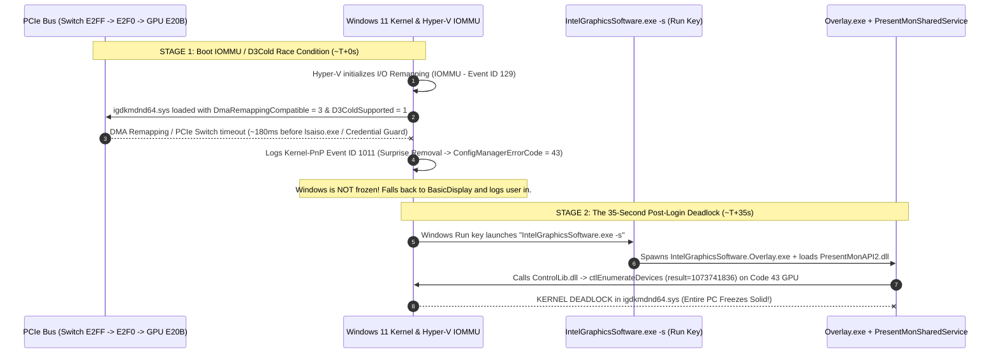

# Intel Arc B580 / Battlemage & Alchemist — Startup Freeze, Code 43 (`Event ID 1011`) & DDU Loop: Forensic Root Cause & Permanent Fix
# Intel Arc B580 — Congelamiento al Iniciar Windows, Código 43 (`Event ID 1011`) y Bucle de DDU: Causa Raíz Forense y Solución Definitiva

[](https://github.com/Juanzor/intel-arc-b580-freeze-fix)
[](https://github.com/Juanzor/intel-arc-b580-freeze-fix)
[](./LICENSE)

> **TL;DR (English):** If your **Intel Arc B580** (or other Arc GPU) works fine for days after a clean driver install, then suddenly **freezes Windows solid ~30–40 seconds after booting**, and **every reboot keeps freezing** until you boot into **Safe Mode and run DDU (Display Driver Uninstaller)** — **your GPU hardware is NOT dying, and your driver files are NOT corrupted.**
> We captured millisecond-level kernel and WMI forensic logs across multiple crashes and proved it is a **two-stage software deadlock**:
> 1. **Stage 1 (Silent Boot Drop to `Code 43`):** Intel's DCH INF (`iigd_dch_d.inf`) enables **Kernel DMA Remapping (`DmaRemappingCompatible = 3`)** and **PCIe `D3Cold` (`D3ColdSupported = 1`)**. On Windows 11 (especially 24H2, where **VBS / Hyper-V IOMMU / LSA Credential Guard `lsaiso.exe`** remain active even after disabling "Memory Integrity / HVCI" in the GUI), an IOMMU DMA page-table initialization race condition during cold boot causes the PCIe switch (`VEN_8086&DEV_E2F0` $\rightarrow$ `DEV_E20B`) to drop out with **`Kernel-PnP Event ID 1011` (`ConfigManagerErrorCode = 43`)** ~200 ms before `wininit.exe` starts `lsaiso.exe`. Windows is **not** frozen yet — it boots to the desktop on `BasicDisplay`.
> 2. **Stage 2 (The 35-Second Post-Login Kernel Deadlock):** ~35 seconds after login, Windows auto-starts `IntelGraphicsSoftware.exe -s`, which spawns `IntelGraphicsSoftware.Overlay.exe` and connects to `PresentMonSharedService` (`PresentMonService.exe` / `PresentMonAPI2.dll`). When `Overlay.exe` invokes `ControlLib.dll` (`ctlEnumerateDevices`, `result=1073741836`) against the `igdkmdnd64.sys` driver while the GPU is in `Code 43`, **the Windows kernel deadlocks completely**. Warm reboots (Reset button) do not cut PCIe slot power, leaving the card's internal PCIe switch latched in `Code 43` so every reboot freezes again 35 seconds after login.

> **Resumen Ejecutivo (Español):** Si tu **Intel Arc B580** funciona perfecto durante varios días tras instalar el driver y de repente **congela Windows por completo unos ~30–40 segundos después de iniciar sesión**, obligándote a entrar en **Modo Seguro y pasar DDU** porque cada reinicio vuelve a congelar la PC, **no es una falla física de tu placa ni archivos corruptos del driver.**
> Este repositorio contiene el análisis forense milisegundo a milisegundo de los registros del kernel de Windows, la lista completa de todo lo que probamos y **no** funcionó a largo plazo, y el **instalador + guardián automático (`IntelArcBootGuard`)** que soluciona ambas fases del problema para siempre (incluso después de futuras actualizaciones de drivers).

---

## 📑 Table of Contents / Tabla de Contenidos
1. [English Guide](#-english-complete-forensic-analysis--permanent-fix)
   - [Symptoms Checklist](#1-symptoms-checklist)
   - [Everything We Tried That Did NOT Work Permanently](#2-everything-we-tried-that-did-not-work-permanently-and-why)
   - [The Exact Two-Stage Freeze Mechanism (Forensic Proof)](#3-the-exact-two-stage-freeze-mechanism-forensic-proof)
   - [How the Permanent Fix & Self-Healing Guard Work](#4-how-the-permanent-fix--self-healing-guard-work)
   - [1-Click Installation](#5-1-click-installation)
2. [Guía en Español](#-español-análisis-forense-completo-y-solución-definitiva)
   - [Síntomas Exactos](#1-síntomas-exactos)
   - [Todo lo que Intentamos y NO Funcionó a Largo Plazo](#2-todo-lo-que-intentamos-y-no-funcionó-a-largo-plazo-y-por-qué)
   - [La Causa Raíz Exacta en 2 Fases (Evidencia Forense)](#3-la-causa-raíz-exacta-en-2-fases-evidencia-forense)
   - [Qué Hace la Solución Definitiva y el Guardián Automático](#4-qué-hace-la-solución-definitiva-y-el-guardián-automático)
   - [Instalación en 1 Clic](#5-instalación-en-1-clic)

---

# 🌎 [English] Complete Forensic Analysis & Permanent Fix

## 1. Symptoms Checklist
Does your system match these symptoms?
- **Hardware:** Intel Arc B580 (`PCI\VEN_8086&DEV_E20B`), B570, A770, or A750 (especially common on AMD AM5 Ryzen 7000/9000 + B650/X670 motherboards, though also seen on Intel platforms).
- **OS:** Windows 11 (23H2 / 24H2 / IoT Enterprise LTSC / Pro / Home).
- **The Cycle:**
  1. You run DDU in Safe Mode and cleanly install the latest Intel Arc WHQL driver (e.g., `32.0.101.9030`, `32.0.101.9150`, etc.).
  2. The PC works flawlessly for **5 to 15 days** (heavy gaming, Warzone, 144Hz+, zero crashes).
  3. One day, you turn on or restart the PC. You log into Windows, the desktop loads for **~30 to 40 seconds**, and suddenly the **entire PC freezes solid** (screen frozen, cursor dead, audio stops, `NumLock` unresponsive).
  4. You press the physical **Reset** or **Power** button. Windows boots again, you log in, and **35 seconds later it freezes solid again**.
  5. The **only** way out of the freeze loop is booting into **Windows Safe Mode**, running **DDU**, and reinstalling the driver — until it happens again a week or two later.

---

## 2. Everything We Tried That Did NOT Work Permanently (And Why)

Before uncovering the two-stage kernel mechanism, we systematically tested every standard recommendation found on Reddit (`r/IntelArc`), Intel Communities, and PC hardware forums. Here is why each of them failed to permanently stop the freeze:

| # | Attempted Fix | Result | Why It Didn't Permanently Solve It |
| :--- | :--- | :--- | :--- |
| **1** | **Disabling Windows Fast Startup (`powercfg /h off`, `HiberbootEnabled = 0`)** | ❌ **Failed after ~1 week** | Fast Startup causes hybrid hibernation issues on warm boots, so disabling it is good practice. However, the `Event ID 1011` surprise removal happens during a **true cold boot** when `wininit.exe` initializes IOMMU / VBS. |
| **2** | **BIOS Settings: Resizable BAR (`Enabled`), Above 4G Decoding (`Enabled`), CSM (`Disabled`)** | ❌ **Already set; still froze** | Essential for Intel Arc performance, but does not prevent the Windows 11 IOMMU DMA remapping race condition on `igdkmdnd64.sys`. |
| **3** | **Monitor / Display Tweaks: Disabling Windows Dynamic Refresh Rate (DRR), locking 144Hz, Borderless vs. Exclusive Fullscreen** | ❌ **Still froze at boot** | Improves in-game frame pacing, but has no effect on early Kernel-PnP initialization or `PresentMon` startup deadlocks. |
| **4** | **Disabling Memory Integrity (`HVCI = 0`) via the Windows Security GUI** | ⚠️ **Lasted ~10–14 days, then froze again** | **Crucial trap:** Turning off "Memory Integrity" sets `HypervisorEnforcedCodeIntegrity\Enabled = 0`, **but on Windows 11 24H2**, `EnableVirtualizationBasedSecurity = 1` and `LsaCfgFlagsDefault = 2` (**Credential Guard / `lsaiso.exe`**) remain active! The Hyper-V hypervisor still initializes **IOMMU (`Event ID 129`)** on every boot. |
| **5** | **Running DDU in Safe Mode & Clean-Installing Newer WHQL Drivers (`32.0.101.9030` $\rightarrow$ `32.0.101.9150`)** | ⚠️ **Temporary relief only** | Every new Intel WHQL driver `.inf` (`iigd_dch_d.inf`) overwrites the registry and re-enables `DmaRemappingCompatible = 3`, `D3ColdSupported = 1`, `IntelGraphicsSoftware.Overlay.exe`, and `PresentMonSharedService`. |

---

## 3. The Exact Two-Stage Freeze Mechanism (Forensic Proof)

By cross-referencing `System`, `Microsoft-Windows-Kernel-PnP/Device Management`, `Intel-IGS-Logs/Service`, `Intel-IGS-Logs/App`, `Intel-IGS-Logs/Overlay`, and WMI device snapshots (`Devices.xml.bak`) captured **during** an active freeze loop, we proved how the bug actually works:



### Forensic Evidence from Windows Event Logs (`2026-10-26` Crash):
1. **`10:59:06.879` — `Microsoft-Windows-Kernel-PnP` (`Event ID 1011`):**
   ```text
   Device PCI\VEN_8086&DEV_E20B&SUBSYS_18771025&REV_00\6&951e780&0&00080009 has been surprise removed as it was reported to be failing.
   ```
2. **`10:59:07.101` (+222 ms later) — `Microsoft-Windows-Wininit` (`Event ID 13`) & `DeviceGuard` (`Event ID 153`):**
   ```text
   Credential Guard (lsaiso.exe) was started and is protecting LSA credentials.
   Virtualization-based security (policies: VBS Enabled, VSM Required) is enabled.
   Hypervisor initialized I/O remapping (IOMMU).
   ```
   *(This identical ~140–222 ms gap between `Event ID 1011` and `Wininit`/`lsaiso.exe` occurred across every single historical crash: `2026-10-05 11:41:20`, `2026-10-11 14:20:11`, and `2026-10-26 10:59:06`.)*
3. **`10:59:08` to `10:59:39` — Windows Runs Normally for 31 Seconds:**
   - WMI snapshot (`Devices.xml.bak`) confirms the GPU is sitting at `ConfigManagerErrorCode = 43` (`Availability = 8`), while the desktop is responsive on the fallback display driver.
4. **`10:59:40.295` to `10:59:41.805` — The Fatal Deadlock (`Intel-IGS-Logs/Overlay`):**
   ```text
   [10:59:40.295] Starting Application "C:\Program Files\Intel\Intel Graphics Software\IntelGraphicsSoftware.Overlay.exe"
   [10:59:40.312] Loading Library: ControlLib.dll
   [10:59:40.315] ctlInit, result=0
   [10:59:40.315] ctlEnumerateDevices, result=1073741825 (No display adapter found)
   [10:59:41.787] Loading Library: PresentMonAPI2.dll
   [10:59:41.805] [Overlay ID:44] ctlEnumerateDevices, result=1073741836
   --- SYSTEM FREEZES SOLID AT 10:59:41.805 ---
   ```
5. **Why Warm Reboots Keep Freezing (`11:01:23` Reboot):**
   - Pressing the Reset button does not cut ATX/PCIe slot power (`3.3Vaux` / `12V`). The Intel Battlemage card's internal PCIe switch (`VEN_8086&DEV_E2FF` $\rightarrow$ `DEV_E2F0`) remains latched in `ConfigManagerErrorCode = 43` across the warm reboot.
   - At `11:01:51.784` (~30s after login), `Overlay.exe` + `PresentMonAPI2.dll` executes `[Overlay ID:44] ctlEnumerateDevices, result=1073741836` and freezes the PC again!
   - **Why DDU in Safe Mode worked:** Safe Mode prevents `Overlay.exe` and `PresentMonSharedService` from running, and DDU's PnP teardown forces Windows to reset the PCIe switch, clearing the latched `Code 43`.

---

## 4. How the Permanent Fix & Self-Healing Guard Work

Our solution ([`scripts/Install-IntelArcFix.ps1`](./scripts/Install-IntelArcFix.ps1) + [`scripts/ArcBootGuard.ps1`](./scripts/ArcBootGuard.ps1)) eliminates **both** stages of the failure and installs a permanent `SYSTEM` boot watchdog that survives future driver updates:

1. **Eliminates Stage 1 (`Event ID 1011` / `Code 43` at Boot):**
   - **Disables Kernel DMA Remapping on `igfxnd`:** Sets `HKLM\SYSTEM\CurrentControlSet\Services\igfxnd\Parameters\DmaRemappingCompatible = 0` (overriding the `3` set by Intel's `iigd_dch_d.inf`).
   - **Completely Disables VBS, Credential Guard (`lsaiso.exe`), and Hyper-V IOMMU:** Sets `EnableVirtualizationBasedSecurity = 0`, `LsaCfgFlags = 0`, `LsaCfgFlagsDefault = 0`, `HyperVVirtualizationBasedSecurityOptout = 1`, `bcdedit /set hypervisorlaunchtype off`, and `bcdedit /set vsmlaunchtype Off`.
   - **Disables PCIe `D3Cold` & `ULPS` across the Entire Battlemage PCIe Tree:** Sets `DisableD3Cold = 1` globally and `D3ColdSupported = 0` on every Intel Arc PCIe Switch and GPU node (`VEN_8086&DEV_E2FF`, `E2F0`, `E2F1`, `E20B`, `E2F7`).
2. **Eliminates Stage 2 (The 35-Second Post-Login Kernel Deadlock):**
   - **Removes `IntelGraphicsSoftware.exe -s` Auto-Start** from `HKLM\SOFTWARE\WOW6432Node\Microsoft\Windows\CurrentVersion\Run` (the main Intel Graphics Software control panel still works normally whenever you open it manually).
   - **Neutralizes `IntelGraphicsSoftware.Overlay.exe` and `PresentMonService.exe`:** Stops and renames both executables to `.disabled` in `C:\Program Files\Intel\Intel Graphics Software` and `C:\Program Files\Intel\PresentMonSharedService` (a hidden `SYSTEM` service that even DDU leaves behind!).
   - **Disables Conflictive Intel Background Telemetry/Power Services:** Stops and disables `PresentMonSharedService`, `ESRV_SVC_QUEENCREEK` (*Energy Server*), `USER_ESRV_SVC_QUEENCREEK`, `SystemUsageReportSvc_QUEENCREEK`, `Intel(R) SUR QC SAM`, `IntelCollectorService`, `IntelTelemetryAgent`, `DSAService`, `DSAUpdateService`, `IGSDSserviceDiscrete`, and `IntelGFXFWupdateTool`.
   - **Disables Bloated Event Log Channels:** Disables `Intel-IGS-Logs/Overlay` and `Intel-IGS-Logs/Telemetry` (which otherwise spam 150+ MB of `.evtx` logs).
3. **Installs the Permanent Self-Healing Watchdog (`IntelArcBootGuard`):**
   - Registers a Windows Scheduled Task (`IntelArcBootGuard`) running as `NT AUTHORITY\SYSTEM` (`RunLevel Highest`) at **Windows Startup (`AtStartup`)** and **User Logon (`AtLogOn`)**.
   - **Survives Driver Updates:** Whenever you install a new Intel Arc driver in the future, `ArcBootGuard.ps1` automatically re-applies `DmaRemappingCompatible = 0`, `D3ColdSupported = 0`, and re-disables `Overlay.exe` / `PresentMonService.exe` on the very next boot.
   - **Automatic PCIe Self-Healing (Zero Safe Mode / Zero DDU):** If `PCI\VEN_8086&DEV_E20B` ever reports `ConfigManagerErrorCode != 0` (`Code 43`) during boot, `ArcBootGuard.ps1` automatically intercepts it, resets the parent PCIe switch port (`VEN_8086&DEV_E2F0`) and GPU (`VEN_8086&DEV_E20B`) via `pnputil /restart-device`, and restores the GPU before your desktop even finishes loading.

---

## 5. 1-Click Installation

### Option A: Double-Click Installer (Recommended)
1. Clone or download this repository.
2. Double-click **`Install-Fix.bat`** (accept the Administrator UAC prompt).
3. Reboot your PC once. Done!

### Option B: PowerShell Command
Open PowerShell as **Administrator** and run:
```powershell
Set-ExecutionPolicy Bypass -Scope Process -Force
.\scripts\Install-IntelArcFix.ps1
```

### Diagnostic Only (Read-Only Check)
Want to check if your PC has the vulnerable settings or past `Event ID 1011` logs before installing? Run:
```powershell
.\scripts\Diagnose-IntelArc.ps1
```

---
---

# 🇦🇷 [Español] Análisis Forense Completo y Solución Definitiva

## 1. Síntomas Exactos
¿Tu PC presenta este comportamiento con una **Intel Arc B580** (o serie Arc B570 / A770 / A750)?
- **El ciclo clásico del problema:**
  1. Entrás en Modo Seguro, pasás **DDU (Display Driver Uninstaller)** e instalás el último driver WHQL de Intel en limpio.
  2. La PC anda perfecta durante **1 a 2 semanas** (jugando a 144 Hz, Warzone, uso intensivo, sin un solo problema).
  3. Un día prendés la PC, iniciás sesión en Windows, el escritorio funciona durante **~30 a 40 segundos** y de golpe **se congela absolutamente todo** (mouse clavado, imagen congelada, teclado sin respuesta).
  4. Tocás el botón físico de **Reset** en el gabinete. Windows vuelve a arrancar, entrás al escritorio y **a los 35 segundos se vuelve a congelar**.
  5. La **única** forma de destrabar la PC es entrar en **Modo Seguro** (donde no se congela), pasar **DDU** y reinstalar el driver... hasta que 10 días después vuelve a pasar.

---

## 2. Todo lo que Intentamos y NO Funcionó a Largo Plazo (y Por Qué)

Durante semanas probamos todas las soluciones que suelen recomendarse en foros, Reddit e Intel Support. Documentamos acá por qué ninguna resolvía el problema de raíz:

1. **Intento 1 — Desactivar el Inicio Rápido de Windows (`powercfg /h off` / `HiberbootEnabled = 0`) y limpiar `PRI-Driver`:**
   - **Qué pasó:** Evitó problemas de hibernación híbrida, pero el congelamiento volvió a ocurrir en un encendido en frío.
   - **Por qué no alcanzó:** El `Event ID 1011` ocurre durante la inicialización en frío del hipervisor IOMMU de Windows, no solo al salir de hibernación.
2. **Intento 2 — Configuración de BIOS (Resizable BAR `Enabled`, Above 4G Decoding `Enabled`, CSM `Disabled`):**
   - **Qué pasó:** Ya estaban activados correctamente en la motherboard (ASRock B650M-H/M.2+ BIOS 4.43 con Ryzen 5 7600).
   - **Por qué no alcanzó:** Son obligatorios para que la arquitectura Xe2/Battlemage rinda bien, pero no evitan el conflicto de remapeo DMA del driver en Windows 11.
3. **Intento 3 — Ajustes de Monitor y Frecuencia (Dynamic Refresh Rate en `Off`, fijar 144 Hz, Low Latency Mode):**
   - **Qué pasó:** Mejoró la estabilidad de FPS en juegos, pero el cuelgue en el arranque siguió apareciendo.
4. **Intento 4 — Desactivar "Integridad de Memoria" (`HVCI = 0`) desde Seguridad de Windows:**
   - **Qué pasó:** Pareció solucionarlo durante ~10–15 días, pero **volvió a congelarse**.
   - **Por qué falló (La trampa de Windows 11 24H2):** Apagar la casilla "Integridad de memoria" pone `HypervisorEnforcedCodeIntegrity\Enabled = 0`, pero Windows 11 24H2 **deja activados `EnableVirtualizationBasedSecurity = 1` y `LsaCfgFlagsDefault = 2` (Credential Guard / `lsaiso.exe`)**. Por lo tanto, el hipervisor Hyper-V e **IOMMU (`Event ID 129`)** seguían levantándose en cada arranque.
5. **Intento 5 — Pasar DDU en Modo Seguro y actualizar a nuevos drivers WHQL (`32.0.101.9030` $\rightarrow$ `32.0.101.9150`):**
   - **Qué pasó:** Destrababa la PC en el momento, pero a los 10 días volvía a congelarse.
   - **Por qué falló:** Cada vez que instalás un driver de Intel, su archivo `.inf` (`iigd_dch_d.inf`) vuelve a escribir `DmaRemappingCompatible = 3`, vuelve a activar `D3ColdSupported = 1`, y vuelve a instalar `IntelGraphicsSoftware.Overlay.exe` + `PresentMonSharedService`.

---

## 3. La Causa Raíz Exacta en 2 Fases (Evidencia Forense)

Al analizar milisegundo a milisegundo los eventos del kernel en tres congelamientos distintos (`05/10/2026`, `11/10/2026` y `26/10/2026`), descubrimos que el fallo ocurre en **dos etapas separadas por ~35 segundos**:

### Fase 1: Desconexión silenciosa en el arranque (`Event ID 1011` $\rightarrow$ `Código 43`)
- El archivo `iigd_dch_d.inf` del driver de Intel aplica la sección `[DMAr_AddReg3]`, que configura `HKLM\SYSTEM\CurrentControlSet\Services\igfxnd\Parameters\DmaRemappingCompatible = 3` (obligando al driver `igdkmdnd64.sys` a usar aislamiento de tablas DMA por IOMMU siempre que VBS/Hyper-V esté activo) y activa `D3ColdSupported = 1`.
- Durante el arranque en frío, exactamente **~140 a 222 ms** cuando `wininit.exe` inicializa **VBS + Credential Guard (`lsaiso.exe`) + Hyper-V IOMMU (`Event ID 129`)**, el switch PCIe interno de la Intel Arc B580 (`VEN_8086&DEV_E2FF` $\rightarrow$ `DEV_E2F0` $\rightarrow$ `DEV_E20B`) sufre un timeout y el kernel registra el **`Event ID 1011`**:
  > *`Device PCI\VEN_8086&DEV_E20B... has been surprise removed as it was reported to be failing.`*
- En ese instante (`10:59:06`), la placa queda en **`ConfigManagerErrorCode = 43`**, pero **Windows NO se congela**: entra al escritorio normalmente usando el adaptador básico de pantalla.

### Fase 2: El deadlock mortal a los 35 segundos de iniciar sesión (`Overlay.exe` + `PresentMon`)
- Exactamente **34 segundos después** (`10:59:40`), el registro `Run` de Windows ejecuta `"IntelGraphicsSoftware.exe" -s`, que a su vez lanza `IntelGraphicsSoftware.Overlay.exe` y carga `PresentMonAPI2.dll` (conectado al servicio de sistema `PresentMonSharedService`).
- Cuando `Overlay.exe` ejecuta la llamada `[Overlay ID:44] ctlEnumerateDevices` (`ControlLib.dll`) hacia el driver `igdkmdnd64.sys` mientras la GPU está en `Código 43`, **el driver entra en un deadlock de kernel y congela toda la PC en el acto (`10:59:41.805`)**.
- **¿Por qué tocar el botón de Reset no lo arreglaba y DDU sí?**
  - Al tocar el botón de Reset (*Warm Reboot*), nunca se corta la alimentación eléctrica de la ranura PCIe. El switch PCIe interno de la placa (`DEV_E2FF` / `DEV_E2F0`) vuelve a arrancar **todavía trabado en `Código 43`** y 35 segundos después `Overlay.exe` vuelve a congelar la PC.
  - Entrar en Modo Seguro evitaba que corriera `Overlay.exe`, y ejecutar DDU forzaba un reseteo lógico del árbol PCIe que limpiaba el `Código 43`.

---

## 4. Qué Hace la Solución Definitiva y el Guardián Automático

El instalador de este repositorio ([`Install-Fix.bat`](./Install-Fix.bat) / [`scripts/Install-IntelArcFix.ps1`](./scripts/Install-IntelArcFix.ps1)) aplica **todas las correcciones de raíz** e instala el servicio guardián [`scripts/ArcBootGuard.ps1`](./scripts/ArcBootGuard.ps1):

1. **Corta la Fase 1 de raíz (Impide el `Event ID 1011` / `Code 43`):**
   - Fuerza `DmaRemappingCompatible = 0` en `HKLM\SYSTEM\CurrentControlSet\Services\igfxnd\Parameters`.
   - Desactiva por completo **VBS, Credential Guard (`lsaiso.exe`) e Hyper-V IOMMU** (`EnableVirtualizationBasedSecurity = 0`, `LsaCfgFlags = 0`, `LsaCfgFlagsDefault = 0`, `HyperVVirtualizationBasedSecurityOptout = 1`, `bcdedit /set hypervisorlaunchtype off`, `bcdedit /set vsmlaunchtype Off`).
   - Desactiva **PCIe `D3Cold` y `ULPS`** en todo el árbol PCIe de la GPU (`DisableD3Cold = 1` y `D3ColdSupported = 0` en los dispositivos `VEN_8086&DEV_E2FF`, `E2F0`, `E2F1`, `E20B`, `E2F7`) y ajusta `TdrDelay = 10`.
2. **Corta la Fase 2 de raíz (Impide el congelamiento a los 35 segundos):**
   - Elimina el auto-inicio oculto `IntelGraphicsSoftware.exe -s` del arranque de Windows (podés seguir abriendo la app *Intel Graphics Software* manualmente cuando quieras).
   - Detiene y neutraliza `IntelGraphicsSoftware.Overlay.exe` y `PresentMonService.exe` (tanto en la carpeta de la app como en `C:\Program Files\Intel\PresentMonSharedService`).
   - Deshabilita los servicios en segundo plano conflictivos de Intel (`PresentMonSharedService`, `ESRV_SVC_QUEENCREEK`, `USER_ESRV_SVC_QUEENCREEK`, `SystemUsageReportSvc_QUEENCREEK`, `Intel(R) SUR QC SAM`, `IntelCollectorService`, `IntelTelemetryAgent`, `DSAService`, `DSAUpdateService`, `IGSDSserviceDiscrete`, `IntelGFXFWupdateTool`).
3. **Instala el Guardián Automático `IntelArcBootGuard` (Inmune a futuras actualizaciones de drivers):**
   - Registra una tarea programada como `NT AUTHORITY\SYSTEM` que se ejecuta en cada encendido (`AtStartup`) e inicio de sesión (`AtLogOn`).
   - Si el día de mañana actualizás el driver de Intel y el instalador pisa el registro, **`ArcBootGuard.ps1` vuelve a aplicar `DmaRemappingCompatible = 0`, `D3ColdSupported = 0` y neutraliza `Overlay.exe` automáticamente en el siguiente arranque**.
   - Si por cualquier motivo la placa llegara a reportar `ErrorCode != 0` en el boot, el guardián **resetea automáticamente el switch PCIe (`pnputil /restart-device`) en caliente** antes de entrar al escritorio, sin que tengas que usar Modo Seguro ni DDU nunca más.

---

## 5. Instalación en 1 Clic

1. Descargá o cloná este repositorio.
2. Hacé doble clic en **`Install-Fix.bat`** y aceptá el cartel de Administrador (UAC).
3. Reiniciá la PC una vez. ¡Listo!

---

## 📂 Repository Structure / Estructura del Repositorio

- [`Install-Fix.bat`](./Install-Fix.bat) — 1-click launcher (auto-elevates to Administrator).
- [`scripts/Install-IntelArcFix.ps1`](./scripts/Install-IntelArcFix.ps1) — Complete installer & registry/BCD hardener.
- [`scripts/ArcBootGuard.ps1`](./scripts/ArcBootGuard.ps1) — `SYSTEM` startup/logon self-healing guard.
- [`scripts/Diagnose-IntelArc.ps1`](./scripts/Diagnose-IntelArc.ps1) — Read-only diagnostic tool to inspect your PC's current state.
- [`scripts/Uninstall-IntelArcFix.ps1`](./scripts/Uninstall-IntelArcFix.ps1) — Clean uninstaller / rollback script.
- [`docs/FORENSIC_TIMELINE_EN.md`](./docs/FORENSIC_TIMELINE_EN.md) — Millisecond-level forensic log breakdown (English).
- [`docs/FORENSIC_TIMELINE_ES.md`](./docs/FORENSIC_TIMELINE_ES.md) — Cronología forense detallada de los registros del kernel (Español).
- [`llms.txt`](./llms.txt) — Structured summary optimized for AI search engines and LLMs.
